<h1 align="center">Mohammad Issa</h1>

  Full-Stack Web Developer &nbsp;·&nbsp; .NET & C# &nbsp;·&nbsp; React &nbsp;·&nbsp; Python & Flask

  

---

## 👤 About

- 💻 Full-stack web developer building complete web applications, from the database and REST API to the user interface
- ⚙️ Backend work with ASP.NET Core, C# and Flask: APIs, application logic, authentication and database design
- 🎨 Frontend work with React, JavaScript, HTML and CSS, focused on clean, responsive interfaces
- 🚀 Ship projects end to end with Git, Docker, CI/CD with GitHub Actions, and cloud deployment

---

## 🛠️ Tech Stack

**Frontend**

&nbsp;
&nbsp;
&nbsp;

**Backend**

&nbsp;
&nbsp;
&nbsp;

**Databases**

&nbsp;
&nbsp;

**Tools & Deployment**

&nbsp;
&nbsp;
&nbsp;
&nbsp;
&nbsp;

---

## 🚀 Featured Projects

<table width="100%" cellspacing="0" cellpadding="15">
<tr>

<td width="50%" valign="top">

<h3>🏟️ Ehjoz — Stadium Reservation & Management System</h3>

<em>.NET · C# · SQL Server</em>

A full-stack web application where users browse sports facilities, book time slots, and stadium owners manage their operations.

<ul>
<li>Built the full application with .NET and C#</li>
<li>Designed the database for users, stadiums and reservations</li>
<li>Implemented booking workflows and reservation logic</li>
<li>Created interfaces for both customers and stadium admins</li>
</ul>

</td>

<td width="50%" valign="top">

<h3>🏥 QCare — Smart Clinic Management Platform</h3>

<em>ASP.NET Core · React · PostgreSQL · Docker · AWS</em>

A full-stack healthcare management web platform with secure, role-based access for clinic staff and patients.

<ul>
<li>ASP.NET Core REST API backend</li>
<li>React frontend application</li>
<li>JWT authentication with role-based access control</li>
<li>PostgreSQL database</li>
<li>Docker containers, deployed to AWS via a GitHub Actions CI/CD pipeline</li>
</ul>

</td>

</tr>
<tr>

<td width="50%" valign="top">

<h3>🌌 Galaxy Website</h3>

<em>Python · Flask · HTML/CSS · JavaScript</em>

A full-stack informational web application about galaxies, with a Flask backend and an interactive, responsive interface.

<ul>
<li>Built the backend routes and application logic in Flask</li>
<li>Structured the site's content and page architecture</li>
<li>Designed a responsive frontend with HTML, CSS and JavaScript</li>
</ul>

</td>

<td width="50%" valign="top">

<h3>🇱🇧 Lebanon Tourism App</h3>

<em>Java · Android Studio · Firebase Firestore</em>

A mobile app showcasing tourism destinations across Lebanon, with information on landmarks, locations and attractions.

<ul>
<li>Built the Android app in Java with Android Studio</li>
<li>Designed screens for browsing destinations</li>
<li>Connected Firebase Firestore for real-time data storage and retrieval</li>
</ul>

</td>

</tr>
</table>

<em>More projects coming soon...</em>

---

## 🔗 Connect

&nbsp;

---

<!-- Contribution Snake -->

